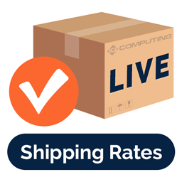

# Live Rates for ShipStation by IQComputing

Live Rates for ShipStation is a free Open Source plugin that works with [ShipStation](https://www.kqzyfj.com/click-101532691-15733876) and [WooCommerce](https://woocommerce.com/) to pull in shipping estimates from the most common shipping providers.

**ShipStation** is a 3rd party provider helping WooCommerce store owners compare shipping carrier rates, automate shipping processes, print labels, sync order data, and group tracking information, among other features.

This plugin connects to the ShipStation API using an authentication key to display shipping rates from various common carriers supported by ShipStation. This allows store owners to group all their shipping carriers under one umbrella which makes management easier and allows customers to choose the best shipping method for them which leads to happier customers.

In order to use the Live Rates for ShipStation plugin, you must have a [premium ShipStation account with API access](https://www.kqzyfj.com/click-101532691-15733876), and purchased the [ShipStation for WooCommerce](https://woocommerce.com/products/shipstation-integration/) plugin. This plugin **will not work** without access to the ShipStation API which is tied to your premium ShipStation account.

Please review [ShipStations Terms of Service](https://www.shipstation.com/terms-of-service/) and [ShipStations Privacy Policy](https://auctane.com/legal/privacy-policy/) for more information about how your data is managed.

Don't have a ShipStation account? [Open a free ShipStation account today!](https://www.kqzyfj.com/click-101532691-15733876)

## Requirements

Live Rates for ShipStation is free to use, but it does require a premium ShipStation account to access their REST API. In addition, there are plugin requirements as well. Here's a list of requirements in order to use this plugin properly:

1. [A ShipStation Account with API Access](https://www.kqzyfj.com/click-101532691-15733876)
1. [WooCommerce Plugin](https://wordpress.org/plugins/woocommerce/)
1. [ShipStation for WooCommerce Plugin](https://woocommerce.com/products/shipstation-integration/)
1. [Live Rates for ShipStation Plugin](https://wordpress.org/plugins/live-rates-for-shipstation/)

Once you have the above set, you will need to make sure that your ShipStation Plugin is connected to your ShipStation account. We recommend following the [ShipStation documentation](https://woocommerce.com/document/shipstation-for-woocommerce/#setup-and-configuration) regarding their integration wizard.

## Installation and Setup

1. Navigate to WooCommerce > Settings > Integration > ShipStation and enter your ShipStation REST V2 API Key. Please refer to their documentation to [Access the ShipStation API](https://help.shipstation.com/hc/en-us/articles/360025856212-ShipStation-API).
1. Once the API Key has been entered and verified, you may select which carriers you would like to support using the Shipping Carriers select box.
1. Once you have your carriers selected you can navigate to WooCommerce > Settings > Shipping to setup your Shipping Zones.
1. Select a zone and click the Add Shipping Method button at the bottom to add "ShipStation Live Rates".
1. From here you can setup custom boxes and select which services from the previously selected carriers you would like to make available for the selected shipping zone.

For more information, please review our support article [Live Rates for ShipStation](https://www.iqcomputing.com/support/articles/live-rates-for-shipstation/).

## Rate retrieval

Package quotes run up to three requests at a time on hosts with cURL multi support. Other hosts use WordPress's normal HTTP transport.

Quick Rates is used for domestic shipments once the recipient and origin have complete street addresses and contact information. If you ship from the Website Store Address, enter **Store Phone Number** under **WooCommerce > Settings > Integration > ShipStation**. ShipStation warehouse addresses use their existing contact phone. Shipping estimates remain available while checkout details are incomplete and for international shipments.

Quick Rates requests only enabled service codes. For up to 20 boxes, when every selected service supports multiple packages and each packed entry has quantity one, the plugin requests a single shipment quote. Repeated quantity groups and other services use individual package quotes. Shipment quotes retain all box metadata and apply fixed adjustments per packed entry, percentage adjustments to the shipment's shipping amount, and configured box fees.

Recoverable Quick Rates failures fall back to estimates. Authentication failures, transport failures, and rate-limit responses are not immediately retried. Rate-limit cooldowns honor ShipStation's Retry-After header.

For developers, `iqlrss/api/rate_concurrency` controls the batch size (default 3, clamped to 1–6). Return false from `iqlrss/api/quick_rates` to use estimates exclusively.

To investigate slow rates, enable logging and select **Debug** in the ShipStation integration settings, then reproduce the cart. In **WooCommerce > Status > Logs**, open the `live-rates-for-shipstation` log and look for **Shipping calculation timing** (setup, packing, rate retrieval, and total milliseconds) and **ShipStation rate retrieval timing** (endpoint, request counts, concurrency limit, and batch durations). Quick Rates and estimate fallback calls receive separate retrieval summaries. These summaries contain timings and counts rather than customer addresses or credentials. Logging stays subject to the existing logging and level settings.

Run the regression suite against an extracted WordPress installation with `IQLRSS_WP_ROOT=/path/to/wordpress php tests/rate-retrieval.php`. The suite uses mock API responses and a local HTTP fixture; it does not require ShipStation credentials.

## Support

This is a free plugin entirely volunteer run. While we will ensure that the plugin is up-to-date for any security issues or breakfixes, we cannot commit to supporting any customizations to the plugin or feature requests, but welcome these questions and requests through the [WordPress Support Forums](https://wordpress.org/support/plugin/live-rates-for-shipstation/) for our team to consider in a future release of the plugin. We recommend using the WordPress Forums for all inquiries.

## Filter Hooks

- `iqlrss/api/rate_concurrency`
- `iqlrss/api/quick_rates`
- `iqlrss/cache/shipstation`
- `iqlrss/cache/shipstation_expires`
- `iqlrss/shipping/calculator_object`
- `iqlrss/shipping/packages`
- `iqlrss/zone/package_presets`
- `iqlrss/zone/settings`